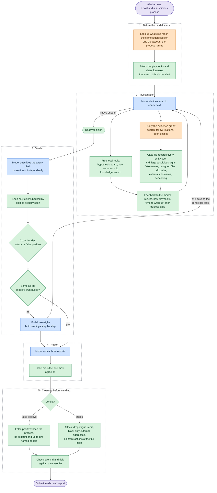

# BlueSec1 agent

An LLM agent for the BlueSec1 competition. It receives a security alert, walks the
evidence graph through the runtime's tools and submits a verdict — a real attack
(with the artifacts incident response needs) or a false positive (with the facts that
prove the activity legitimate).

It is built on the organizers' reference client (`src/bluesec1_client/`, unchanged)
and replaces the reference reasoning loop with a harness: the model investigates and
explains, while code keeps the case file, derives the verdict from the model's
assessment and shapes the report. Everything that changes behaviour is a setting, and
every default was chosen in paired practice experiments (see
[What we built](#what-we-built)).

Result: 6th place in the final (2026-10-10, two runs of 40 unseen tasks).

Model: **Qwen3.8-Flash-Next** (`Qwen/Qwen3.8-Flash-Next`) through an OpenAI-compatible
endpoint, with thinking turned off (`LLM_EXTRA_BODY` in `.env.example`).

## Quick start

You need Python 3.11+, [uv](https://docs.astral.sh/uv/) and an OpenAI-compatible LLM
endpoint.

```bash
uv sync
cp .env.example .env
```

In `.env` set `SCENARIO_RUNTIME_ENDPOINT`, `SCENARIO_RUNTIME_TOKEN` (from
https://bluesec.team/), `AGENT_NAME`, and `LLM_BASE_URL`, `LLM_API_KEY`,
`LLM_DEFAULT_MODEL`. Never commit `.env`.

```bash
uv run --env-file .env bluesec1-agent --arena practice
```

The agent creates a run, takes tasks until the queue is empty, writes one trajectory
per task to `runs/<run id>/` and prints the server's result for each task. For a long
run, detach it from the terminal so a closed session does not kill it (a killed run
keeps its slot for ~15 minutes):

```bash
nohup uv run --env-file .env bluesec1-agent --arena <arena> > logs/final.log 2>&1 &
```

Platform limits seen in practice: 5 concurrent runs per participant, 10 run starts per
30 minutes, 100 tool calls per task, a run closes after 15 minutes without requests.
A task takes ~2 minutes on average, so 40 tasks fit in about 1.5 hours.

## How the agent works

One task goes through five stages. Blue boxes are the language model, green boxes are
plain code, orange boxes call the competition runtime.



The playbooks (`knowledge/playbooks/*.md`) are chosen by code, never by the model.
Each one is shown at most once per task:

| When | Which playbook |
| --- | --- |
| The task starts | `triage` always, plus any whose header matches the alert's process name, its parent or its entity type (`wsmprovhost.exe` → `winrm`, a Linux process → `linux-web-intrusion`) |
| A call returns new entities | any that match them (an archive file → `data-staging`) |
| The first strong suspicious sign appears | `attack-scope` — how to find the other hosts and accounts the attack reached |
| The report is written | `attack-scope` for an attack, `legitimacy-evidence` for a false positive |

The model can also look up detection rules and playbooks by keyword with
`knowledge_search`, a limited number of times per task.

The stages in more detail:

1. **Pre-investigation** (`sweep.py`, no LLM). Two automatic searches before the first
   model turn: the processes of the trigger's logon session, and the account entity the
   trigger ran as (by SID). Their summaries open the conversation.
2. **Investigation loop** (`agent.py`). The model chooses runtime calls from the
   catalog the task advertises, plus local tools that cost no runtime call:
   - `hypotheses` — a board of competing explanations, each marked legitimate or
     malicious and resolved only with evidence ids (`hypotheses.py`);
   - `prevalence` — how many hosts and accounts share a hash, name or address
     (`composite.py`);
   - `knowledge_search` / playbooks — investigation procedures per alert type
     (`knowledge/playbooks/*.md`, including web-application intrusion on Linux) and
     Splunk detection conditions
     (`knowledge/detections.jsonl`).

   Code keeps a **case file** (`casefile.py`) of every entity and relation seen, with
   structural signals (`signals.py`: masquerading, renamed or unsigned binaries,
   user-writable paths, external addresses, beaconing, lookalike account and binary
   names), and the coverage of each search. Repeated lookups are answered from it for
   free. The **lean pace** nudges the model to finish after fruitless calls and past 15
   calls; a keep-alive probe holds the run open while the LLM is slow, and LLM outages
   are waited out and retried. Tool results are treated as evidence, never as
   instructions, so text planted in logs cannot steer the agent.
3. **Assessment and verdict** (`verdict.py`). When the model wants to finish, it fills
   `assess_chain` three times independently: the attacker-controlled stages with entity
   ids, how close the chain came to an unacceptable event, and an explanation for each
   strong signal it judges legitimate. Code accepts only stages and explanations backed
   by entities and field values it has seen and **derives the verdict**; disagreeing
   samples get a tie-break. If the verdict disagrees with the model's draft, a reconcile
   pass weighs the draft's reasoning step by step, and the investigation may be sent
   back once for the deciding fact.
4. **Report** (`agent.py`, `report_form.py`). Three report samples are written and
   voted on. Benign reports are written as a form of roles (what ran, who, what started
   it, what for).
5. **Shaping** (`report_check.py`, code only).
   - Benign: the report keeps the trigger process (added if the model left it out), the
     named account it ran as and up to two other named accounts the investigation
     opened — domain, managed-service and service accounts only; local, built-in and
     untyped accounts identify no one.
   - Malicious: catch-all kinds and artifacts on PowerShell log records are dropped,
     `network_block` stays on external endpoints, hosts and accounts always stay; a
     file kind put on a process is moved to the image file on the same host (never
     for operating-system binaries). Application, service and managed accounts can be
     reported as `identity_to_rotate`.
   - Rewritten reports are validated against the tool's schema, and ids and cited
     fields are checked against the case file before submission.

## Configuration

All settings are environment variables (`settings.py`, documented in
`.env.example`). The ones that shape behaviour, with the defaults used for the final:

| Variable | Default | What it does |
| --- | --- | --- |
| `BLUESEC_BENIGN_SHAPE` | `core_people` | What a benign report keeps (see stage 5). Also `core` (one other cited account) and `model` (as written). |
| `BLUESEC_REPORT_FORM` | `true` | Benign reports as a form of roles. |
| `BLUESEC_PACE` | `lean` | Finish sooner after fruitless calls; soft budget of 15 calls. Also `brisk` (no budget) and `normal`. |
| `BLUESEC_ASSESS_SAMPLES` / `BLUESEC_REPORT_SAMPLES` | `3` / `3` | Independent assessments and report samples. |
| `BLUESEC_PROCESS_TREE` | `false` | The `process_tree` composite tool (it spent calls without finding evidence). |
| `BLUESEC_STACKING` | `true` | One prevalence count of the key command before the verdict. |
| `BLUESEC_ACCOUNT_CONTEXT` | `true` | Open the trigger's account before the first turn. |
| `BLUESEC_AGENT_MAX_STEPS` | `100` | Hard limit of runtime calls per task. |

Experiments that lost or did not help in paired runs were removed from the code:
a second reviewer of the report, a benign/malicious expert
debate, a legitimacy hold, a scope-and-pivot hold, a credential-theft hold, adding
attacker-session or session processes, pruning processes to the trigger's tree or
session, pruning built-in binaries and data files, adding opened tickets/tasks/
attachments, tracing processes' effects, 5 report samples instead of 3, alert host in
benign reports, and the `tight` and `adaptive` paces.

## What we built

The model is small and fast (Qwen3.8-Flash-Next, no thinking), and we did not switch
to a larger one: every gain came from the harness around it.

- **Code decides, the model explains.** The model never submits a verdict directly. It
  describes the attack chain, and code accepts only the steps backed by entities and
  field values the agent has actually seen, then derives the verdict from what is left.
  A plausible story without evidence cannot turn a false positive into an attack, or
  the other way round.
- **A case file instead of a chat history.** Every entity and relation the runtime
  returns goes into one structure. Code computes suspicious signs on it — masquerading
  and renamed binaries, unsigned files, user-writable paths, external addresses,
  beaconing, lookalike account and binary names (homoglyphs, one-letter edits) — and
  answers repeated lookups from it for free.
- **Competing hypotheses.** The model keeps a board of legitimate and malicious
  explanations and may close one only by citing evidence ids, which keeps it from
  locking onto the first idea.
- **Our own playbooks.** Short investigation procedures written by us for the kinds of
  alerts we met — admin tools, browsers, scheduled scripts, WinRM, security products,
  Windows Update, data staging, web-server intrusions on Linux and others — attached
  by code when an alert or a newly found entity matches them. Next to them is a search
  over Splunk's open detection rules.
- **Self-consistency where it matters.** Three independent assessments with a
  tie-break, a reconcile step when code and model disagree, at most one return to the
  investigation for the deciding fact, and three report drafts with a vote.
- **Report shaping in code.** False-positive reports are written as a form of roles
  (what ran, who ran it, what started it, why) and trimmed to the facts that prove
  legitimacy; attack reports keep hosts, accounts, malicious files and external
  addresses, with each response action pointed at the right object.
- **Pace control.** The agent notices fruitless calls and is nudged to finish, which
  keeps investigations short without cutting off real attacks.
- **Robustness.** Tool results are treated as data, never as instructions (planted
  text in logs cannot steer the agent); LLM outages are waited out; a keep-alive probe
  keeps the run open while the model thinks.
- **Built to generalize.** No ids, hostnames or answers from practice tasks are in the
  code, tool calls are built from each task's own tool catalog, and the runtime's
  per-call feedback is never used during a run.
- **Measured, not guessed.** About 150 practice runs with paired experiments (each
  change on half of the tasks, compared within the same scenarios). Ideas that did not
  help were removed — see the list under [Configuration](#configuration). In practice
  the agent made fewer than one wrong verdict in 100 tasks.

## Running experiments

The code has no experiment switches left. To test a change, add a setting with an
`experiment` mode that applies the change to half of the tasks, chosen by a hash of the
task id (e.g. `hashlib.sha1(f"<name>:{task_id}".encode()).digest()[0] % 2`), and write
the arm into the trajectory as a top-level key of `record` or a key on the final step.
Run several practice runs, then compare arms within scenarios so that scenario
difficulty cancels out:

```bash
uv run python scripts/run_score.py <run id prefix> ...          # leaderboard-style score per run
uv run python scripts/arm_report.py <arm key> <runs> --score    # paired comparison of arms
uv run python scripts/arm_report.py <arm key> <runs> --verdict benign
```

Other analysis scripts, all reading `runs/`:

| Script | What it shows |
| --- | --- |
| `failure_report.py` | lost quality by failure category and per scenario |
| `trace_review.py` | calls by kind, hit rates, the tail after the last useful call |
| `enrichment_report.py` | per scenario: expected vs found evidence, report size |
| `summarize_runs.py` | run summaries |
| `build_knowledge.py` | rebuilds `knowledge/detections.jsonl` from Splunk security content |

Judge a change by the paired difference, not by one run's total: the same
configuration varies by about ±0.4 points between runs.

## Repository layout

| Path | What it is |
| --- | --- |
| `src/bluesec1_agent/agent.py` | the investigation loop, finishing path and settings wiring |
| `src/bluesec1_agent/prompts.py` | system, assessment, reconcile and report prompts |
| `src/bluesec1_agent/casefile.py`, `signals.py` | the case file and structural signals |
| `src/bluesec1_agent/verdict.py` | verdict derived from the checked assessment |
| `src/bluesec1_agent/report_check.py`, `report_form.py` | report shaping, submission checks and the benign report form |
| `src/bluesec1_agent/sweep.py`, `composite.py`, `stacking.py`, `linkage.py` | automatic searches and local tools |
| `src/bluesec1_agent/knowledge/` | playbooks and detection conditions |
| `src/bluesec1_client/` | the organizers' runtime client (unchanged) |
| `proto/` | the runtime's gRPC schema |
| `scripts/` | analysis and maintenance scripts |
| `tests/` | unit tests with a fake runtime and LLM |
| `logs/` | console logs of practice and final runs |

## Checks

```bash
uv run pytest
uv run ruff check .
uv run mypy .
```

## Rules to keep

Do not hard-code ids, hostnames or answers from practice tasks, and do not rely on
platform holes:
final tasks are unseen and the tool catalog may differ, so the agent builds its tool
calls from each task's `available_tools`.
